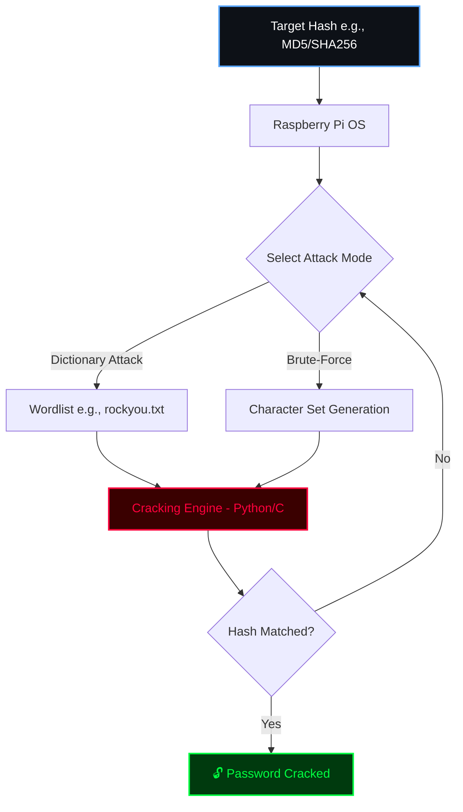

# 🍓 Raspberry Pi Hardware Password Cracker

A custom, low-budget hardware password cracking rig built from scratch using a Raspberry Pi. This project was developed to understand the mechanics of offline brute-force and dictionary attacks against hashed passwords in a controlled, educational lab environment.

> *"To defend a system, you must first understand how to break it."*

---

## 🏗️ Architecture & Attack Flow

The following diagram illustrates the workflow of the cracking rig, from hash input to password recovery:

🛠️ Hardware & Software Stack

Component Details
Hardware Raspberry Pi (ARM Architecture)
OS Raspberry Pi OS (Debian-based)
Languages Python (Automation & Logic)
Tools Custom Python Script / Hashcat / John the Ripper
Monitoring Thermal monitoring scripts to prevent CPU throttling during heavy loads.

🧠 Key Learnings & Technical Challenges

· Hardware Limitations: Discovered the computational bottleneck of ARM architecture compared to dedicated GPUs (CUDA) when generating high-volume hashes.
· Cryptography: Deepened my understanding of how hashing algorithms work and why salting (adding random data to a password before hashing) is a critical defense against rainbow table attacks.
· Automation & Scripting: Built Python scripts to automate the cracking process, parse wordlists, and output real-time telemetry to the terminal.
· Hardware Management: Implemented temperature checks to ensure the Raspberry Pi didn't overheat during prolonged cracking sessions.

📸 Gallery

(Screenshots of the Raspberry Pi terminal in action, hardware setup, and telemetry will be added to the assets/ folder).

Hardware Setup Cracking in Progress
[Placeholder for image] [Placeholder for image]

🔗 Project Evolution

This project taught me the fundamentals of offensive automation and hardware security. Today, I apply these exact same principles to secure and test Large Language Models (LLMs) in my current AI Security project: Hydra-Prompt-Breaker.

⚠️ Disclaimer

This tool and project were built strictly for educational purposes in a controlled lab environment. Do not use these techniques against systems you do not own or have explicit permission to test. The author is not responsible for any misuse.

---

Built by Gustavo Ramos | AI Security Engineer 